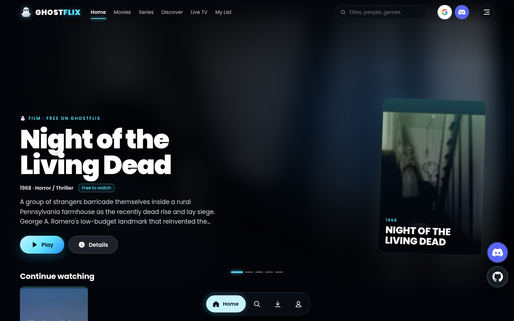

# GhostFlix 👻

A premium, dark, streaming-style catalog for movies and series — part of the GhostGames family.
Metadata comes from [TMDB](https://www.themoviedb.org/); playback comes from trailers, public-domain films and
sources the site owner adds — with a hard denylist of known unlicensed streaming hosts.



## Features

- **Browse**: hero carousel (rating ring, genres, age rating), horizontal rows (Trending, Popular, Top rated, Top 10, genres),
  hover cards, genre pages, search, title pages with cast, trailers, seasons/episodes and *where to watch* (JustWatch data via TMDB).
- **Player**: YouTube trailers by default; full playback for sources the admin attaches — any http(s) embed/video link or
  `<iframe>` code (YouTube, Vimeo, Internet Archive, Dailymotion, Bunny, Cloudflare Stream, own host, MP4/HLS…), or the owner's
  **link patterns**. Subtitles (.srt/.vtt) per title/episode.
- **Admin** (`/admin`, password via `ADMIN_PASSWORD`): add a video to any title/episode, bulk **Import** from a YouTube playlist/channel
  or an Internet Archive collection/search (auto-matched to TMDB by title + year, review before saving), optional daily re-sync,
  one-click *Internet Archive `feature_films`* public-domain seed, unmatched queue, JSON backup/restore.
- **You / Settings**: watch history (clear/remove), appearance (Dark / AMOLED / Dim, accent presets incl. GhostGames cyan,
  poster vs landscape cards, card size, reduced motion), subtitle style (size, colour, background, font, edge, default language),
  player and region preferences, data export/import.
- **Discover**: Top 10 today, trending, coming soon, new episodes, "Because you watched …" from your history, mood shelves.
- **Watch Parties** (`/party`) — *built but disabled by default; set `ENABLE_WATCH_PARTIES=1` to turn on*: share a link; play/pause/seek sync for GhostFlix's own player (MP4/HLS) and YouTube embeds
  (via the iframe postMessage API), chat, emoji reactions, presence and a 3-2-1 countdown for other embeds — over Supabase Realtime
  broadcast channels (no tables needed). Without Supabase config it runs in solo mode.
- **Live TV** (`/live`): guide-style grid of free, legal channels using broadcasters' official YouTube live streams
  (`data/live-channels.json`); admins can add more official channel links.
- **Accounts (optional)**: Supabase Auth with Google and Discord; signed-in users get an avatar menu and their
  watchlist + history synced. Without config everything works locally (localStorage).
- **Demo mode**: with no TMDB key the site runs on a bundled catalog of public-domain classics from the Internet Archive — fully playable.
- Mobile-first: floating bottom dock, slide-out menu, responsive layouts, reduced-motion support.

### Source policy (enforced in code)

`server/sources.js` is the only way a playable source enters the app:

- Admins can paste **any http(s)** video page, embed URL, `<iframe>` code or MP4/WebM/HLS link.
  Well-known providers are normalised and their embed URLs rebuilt server-side; other pages play in a **sandboxed iframe**
  (`allow-scripts allow-same-origin allow-presentation allow-forms` — no popups, no top-level navigation).
- A **hard denylist** of known unlicensed hosts (vidsrc.*, vidcore.org, 2embed.*, multiembed.mov, superembed, embed.su,
  autoembed, vidlink, smashystream, moviesapi.club, …) is rejected on save **and** re-checked at play time; it also applies
  to URLs smuggled in query strings, to restored backups, and to importers. It cannot be overridden by config.
- **Link patterns** (Admin → Link patterns): a movie pattern with `{tmdb_id}` and a series pattern with
  `{tmdb_id}`, `{season}`, `{episode}` for your own host. Titles without a specific source use them automatically.
  Patterns must have a fixed host and are rejected if that host is denylisted.

## Quick start

```bash
npm install
cp .env.example .env     # fill in what you have (all optional)
npm start                # http://localhost:3000
npm test                 # unit tests (denylist, link patterns, title parsing, srt→vtt)
```

## Configuration (`.env` / Render env vars)

| Variable | Needed for |
| --- | --- |
| `TMDB_API_KEY` | Full catalog. v3 API key **or** v4 read token — free at themoviedb.org → Settings → API. Empty = demo catalog. |
| `ADMIN_PASSWORD` | Enables `/admin`. Empty = admin disabled. |
| `SESSION_SECRET` | Signs admin sessions (any long random string). |
| `TMDB_REGION`, `TMDB_LANGUAGE` | Default where-to-watch region (`US`) and metadata language (`en-US`). |
| `SUPABASE_PUBLIC_URL`, `SUPABASE_ANON_KEY` | Sign-in + sync. Public values (URL + anon/publishable key); data is protected by RLS. |
| `AUTH_GOOGLE`, `AUTH_DISCORD` | Set to `false` to hide a provider button. |
| `YOUTUBE_API_KEY` | Optional. Import whole YouTube playlists/channels (without it: latest ~15 via RSS). |
| `CRON_SECRET` | Optional. Protects `POST /api/cron/resync` (header `x-cron-secret`). |
| `SUPABASE_URL`, `SUPABASE_SERVICE_KEY` | Optional server-side persistence of the admin store (see below). **Server only — never expose.** |
| `DISCORD_INVITE_URL`, `GITHUB_URL` | Community links (floating Discord/GitHub buttons, Settings → Connections). Defaults to the GhostGames Discord and the GhostFlix repo. |

### Supabase setup (accounts)

1. Run [`supabase/schema.sql`](supabase/schema.sql) in the Supabase SQL editor (creates `ghostflix_watchlist` and `ghostflix_history` with RLS).
2. Authentication → Providers: enable **Google** and **Discord** (header buttons start each provider's OAuth directly).
3. Authentication → URL Configuration: add your site URL(s) to *Redirect URLs*, e.g. `https://<your-app>.onrender.com/**` and `http://localhost:3000/**`.
4. Set `SUPABASE_PUBLIC_URL` and `SUPABASE_ANON_KEY`.
5. Watch Parties use Realtime *broadcast* + *presence* on public channels named `ghostflix-party-<room>` — nothing to create.

### Where admin data lives

The admin store (sources, subtitles, import jobs) is one JSON document:

- **Default**: `data/store.json` (git-ignored). Render's free disk resets on every deploy/restart, so either
  export it from Admin → Backup and commit it as `data/seed-store.json` (loaded when the store is empty), or
- **Supabase**: run [`supabase/store.sql`](supabase/store.sql) and set `SUPABASE_URL` + `SUPABASE_SERVICE_KEY`.

## Deploy on Render (free)

1. Push this repo to GitHub.
2. Render → New → **Blueprint** → pick the repo (uses `render.yaml`, plan `free`), or New → Web Service with
   build `npm ci --omit=dev`, start `npm start`.
3. Fill in the env vars above. Free instances sleep after ~15 minutes idle; the first request wakes them.
4. Daily re-sync: the server checks hourly while awake. For reliability, point a free external cron (e.g. GitHub Actions or cron-job.org)
   at `POST https://<app>/api/cron/resync` with header `x-cron-secret: <CRON_SECRET>`.

## Project layout

```
server/      Express app, TMDB + demo catalogs, source rules/denylist, importers, store, subtitles
public/      SPA (app.js, settings.js, auth.js), admin UI, styles, logo
data/        demo.json (public-domain demo catalog), seed-store.json (optional)
supabase/    SQL for accounts sync and optional server store
scripts/     build-demo.mjs (regenerate demo data), screens.mjs (headless screenshots)
test/        node:test unit tests
```

## Credits

This product uses the TMDB API but is not endorsed or certified by TMDB. Where-to-watch data is provided by JustWatch.
Demo titles are public-domain or openly licensed works hosted by the Internet Archive.
